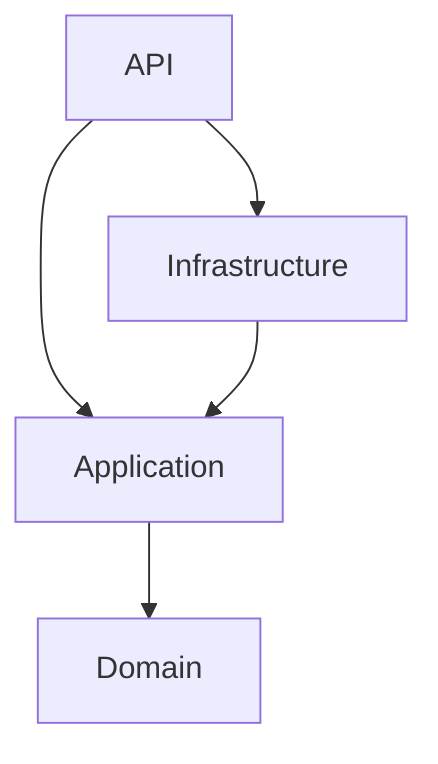

# Clean Architecture, Repository and Unit of Work

NurseNow follows the dependency direction used by the Identity service in FlowERP-Microservices. The repositories and Unit of Work have **interfaces in Application** and **implementations in Infrastructure**. FlowERP itself is unchanged. All projects still target .NET 8.

| Project | Responsibility | Project references |
|---|---|---|
| Domain | Entities and booking overlap rule; plain ApplicationUser | None |
| Application | Use cases, DTOs, repository interfaces, IUnitOfWork and external-service ports | Domain |
| Infrastructure | EF Core repositories, UnitOfWork, SQL Server context/migrations, Identity, JWT, SMTP, Stripe and file storage | Application |
| API | HTTP binding, authorization, result mapping, authentication and dependency injection | Application, Infrastructure |



These arrows show project dependencies, not request order. At runtime a controller calls an application service, which calls repository interfaces; dependency injection supplies the infrastructure implementations.

## Repositories

There are 14 purpose-built repository contracts in `src/NurseNow.Application/Repositories` and matching implementations in `src/NurseNow.Infrastructure/Persistence/Repositories`. They cover the active user/profile, booking, scheduling, service, payment, review, notification, complaint, document and activity-log flows. Archived reports/settings controllers remain archived; unused entities are not newly exposed as endpoints.

Repository methods return entities, materialized DTOs, counts and lists. They do not return DbSet or IQueryable. Filtering, joins, ordering, pagination, aggregation and projection execute inside Infrastructure. `DTOs/Persistence` contains named read projections; existing JSON property spelling is preserved. Read queries use AsNoTracking. Update queries intentionally return tracked entities; the shared context detects property changes.

`Add` and `Remove` only stage changes. Repositories do not call SaveChanges. Read-only services do not need a Unit of Work. There is no generic repository or service locator: each use case explicitly receives the repositories it uses.

## Unit of Work

- Contract: `Application/Abstractions/IUnitOfWork.cs`.
- Implementation: `Infrastructure/Persistence/UnitOfWork.cs`.
- The Unit of Work and all repositories share one scoped ApplicationDbContext.
- `SaveChangesAsync` persists all tracked changes together. EF's relational SaveChanges transaction covers multi-repository writes such as a payment and booking status update.
- `BeginTransactionAsync` starts an explicit serializable transaction for read/check/write flows such as registration and booking overlap checks. Call SaveChangesAsync before CommitAsync. Commit does not implicitly save.
- Disposing a transaction without committing rolls it back. The request scope then disposes its context; do not reuse that context's tracked entities after a rollback.
- The one immediate repository command is notification `MarkAllReadAsync`, which retains EF's efficient set-based update. Both callers wrap it in a Unit of Work transaction. It is not a staged Add/Remove operation; rollback is covered by a regression check.

Example from a write use case:

```csharp
await using var transaction = await _unitOfWork.BeginTransactionAsync(ct);
_bookings.Add(booking);
_notifications.Add(notification);
await _unitOfWork.SaveChangesAsync(ct);
await transaction.CommitAsync(ct);
```

Registration and administrator creation/deletion keep their explicit transaction boundaries. Booking/payment status and review flags keep their existing optimistic concurrency tokens.

## Identity boundary

Application uses IIdentityService and application-owned result types. Domain's ApplicationUser no longer inherits IdentityUser; Domain and Application reference neither EF Core nor ASP.NET Identity.

Infrastructure's IdentityService wraps Microsoft's UserManager. Password hashing, password validation, lockout and reset-token generation/validation still use the existing Identity mechanisms. ApplicationUserStore implements the password, email, security-stamp, role, lockout, phone and two-factor-flag store contracts needed by the current application. It stages writes in the same context as business repositories, so a user, role assignment, profile and activity log can be committed atomically by the Unit of Work. Login failure counters, successful-login resets, password resets and profile changes now explicitly save.

The existing AspNet table names, columns, indexes, keys and relationships are mapped in IdentityModelConfiguration. The regression suite compares the SQL Server relational model against the existing migration snapshot. This refactor introduces no migration. String user IDs, integer business keys and legacy entity namespaces remain unchanged.

External-login, authenticator/recovery-code and user-claim management flows are not implemented by this custom store because the application does not currently expose them. Add the corresponding Identity store contracts and tests before adding those features. Bootstrap roles still use Microsoft's RoleStore inside the startup database transaction.

## HTTP boundary and compatibility

All 104 original active actions retain their verbs/routes and class authorization. Services return OperationResult, mapped by API to HTTP responses. File ownership checks now use INurseDocumentRepository; JWT validation uses IIdentityService. API references the concrete context only for startup database/bootstrap work.

IRequestContext supplies claims, public URL and cancellation without exposing HttpContext or MVC to Application. Existing external API behavior and limitations remain documented in COMPATIBILITY.md and KNOWN_LIMITATIONS.md. Larger application services can be split into narrower use cases separately; that is not required for the persistence boundary.
